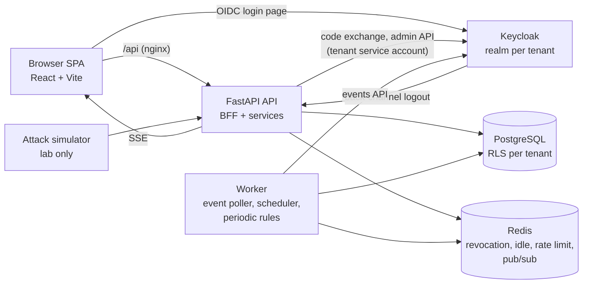

# IdentityShield

Multi-tenant **Identity Threat Detection & Response (ITDR)** platform: IAM done properly
(identity lifecycle, session management, safe logout) plus threat hunting
(12 detections, risk scoring, automated response, hunt console, MITRE ATT&CK mapping).

University project. Source of truth for the design: [`architecture.md`](architecture.md).
Deviations and their reasons: [`docs/DECISIONS.md`](docs/DECISIONS.md).

| Area | Evaluation criterion | Where |
|---|---|---|
| Session management | 5-min access tokens, rotating refresh tokens + reuse detection, 15 min idle / 8 h absolute, device/IP binding, concurrent cap, kill / logout-all | `backend/app/sessions/`, `backend/app/core/deps.py` |
| Identity lifecycle | Joiner / Mover / Leaver, approvals with separation of duties, access diff, idempotent + resumable workflows, HR webhook, scheduled leavers | `backend/app/lifecycle/` |
| Safe logout | Server-side revoke, Redis revocation list (sid + jti), Keycloak SSO end + back-channel logout, cookie clearing, `Cache-Control: no-store`, `Clear-Site-Data`, SPA state wipe, bfcache guard | `backend/app/auth/router.py`, `frontend/src/auth/` |
| Threat hunting | D01–D12, risk scoring, playbooks (DRY_RUN / ACTIVE), 10 prebuilt hunts, ad hoc search, user timeline, live alert push (SSE) | `backend/app/detection/`, `backend/app/hunt/`, `backend/app/response/` |
| IAM package evaluation | Keycloak vs Auth0 vs Okta vs Entra ID vs Cognito | [`docs/report/iam-comparison.md`](docs/report/iam-comparison.md) |

---

## Quick start

Requirements: Docker Desktop (Compose v2), ~4 GB RAM free. Ports 5173, 8000, 8080, 8025 must be free.

```bash
./scripts/init_env.sh                              # creates .env with random secrets (never committed)
docker compose up -d --build                       # postgres, redis, keycloak, mailpit, api, worker, web
docker compose exec api python scripts/seed.py     # demo tenants, users, 30 days of history
```

First start takes ~1–2 minutes (Keycloak boot). Then open:

| URL | What |
|---|---|
| http://localhost:5173 | Dashboard. Organisation `acme`, user `alice` (admin) |
| http://localhost:8080 | Keycloak (admin console: `KC_BOOTSTRAP_ADMIN_*` in `.env`) |
| http://localhost:8025 | Mailpit: joiner invite emails |
| http://localhost:8000/docs | API docs (lab mode only) |

Demo users (password = `DEMO_PASSWORD` in `.env`): `alice` admin · `sam` analyst · `hana` hr · `bob` user.
Second tenant `globex` (`gina` admin) exists for isolation tests.

> Browsers treat `http://localhost` as a secure context, so the `__Host-`/`Secure` cookies work
> locally in Chrome, Edge and Firefox. If you serve the lab on another hostname over plain HTTP,
> set `COOKIE_SECURE=false` in `.env`.

### Run the demo (architecture §14)

```bash
./scripts/demo.sh
```

Runs all nine steps headlessly and checks each outcome. The same flow works from the UI:
**Lifecycle** (Joiner/Mover/Leaver) + **Attack Lab** (runs the simulator scenarios) + **Alerts**,
**User Timeline** and **Audit Log → Verify hash chain**.

### Attack simulator (lab only)

```bash
docker compose run --rm simulator list
docker compose run --rm simulator stolen_session --victim asha --i-understand-lab-only
```

Scenarios: `stolen_session` (D02), `impossible_travel` (D01), `ghost_login` (D04), `brute_force`
(D07 + D08), `credential_stuffing` (D08), `privesc` (D06). The CLI refuses any target that is not
localhost or a Docker-network service, and refuses to run without `--i-understand-lab-only`.

### Tests

```bash
./scripts/test.sh                 # backend: 86 tests, coverage report (82% overall)
cd frontend && npm test           # frontend: Vitest (token handling, route guards)
```

Backend tests run inside the API image against a separate database (`identityshield_test`,
migrated from scratch, accessed as the RLS-bound runtime role) and Redis DB 15, with an in-memory
fake Keycloak. They cover: every rule positive + negative, logout invalidating access token /
refresh token / IdP session, refresh-token reuse, idle + absolute timeouts, concurrent cap,
drift detection, leaver with zero live sessions, failure + retry mid-workflow, cross-tenant
isolation (API and row-level security), audit tampering, every prebuilt hunt against the seed data,
and "every non-public route returns 401 anonymously".

### Deploy to Render (free tier)

`render.yaml` is a Render Blueprint for the whole stack: three free Docker web services
(`identityshield-web`, `identityshield-api`, `identityshield-kc`), a free Postgres and a free Key Value
(Redis). Files under `deploy/render/` adapt the stack to one managed database and no private network.
A Render workspace gets only **one** free Postgres and **one** free Key Value: use a workspace where
they are unused (otherwise see the Neon / Upstash alternative in the header of `render.yaml`).

1. Push this repository to GitHub.
2. In the Render dashboard: **New → Blueprint**, connect the repository, keep the `render.yaml` path.
3. When asked for `DEMO_PASSWORD`, enter the password the demo users will get
   (12+ characters with an upper-case letter, a lower-case letter and a digit). Click **Apply**.
4. Wait for the three services to go live (first build ~10 min; Keycloak boots slowly on 0.1 CPU).
   On first start the API creates the runtime DB role, migrates, waits for Keycloak and seeds the
   demo tenants by itself (watch the `identityshield-api` logs for `Seed complete`).
5. Open `https://identityshield-web.onrender.com`, organisation `acme`, user `alice`.

If Render added a suffix to a service URL (name already taken), set the real URLs in the
`identityshield-api` env vars (`PUBLIC_URL`, `KEYCLOAK_PUBLIC_URL`, `KEYCLOAK_INTERNAL_URL`,
`API_INTERNAL_URL`), `identityshield-kc` (`KC_HOSTNAME`) and `identityshield-web` (`API_HOST`,
`KEYCLOAK_PUBLIC_URL`), then redeploy. Tenant realms created before the change keep the old
redirect URIs: fix them in the Keycloak admin console (client `identityshield-web`).

Free-tier behaviour:

* Services sleep after 15 minutes without traffic; the first visit wakes the web service, the API
  and then Keycloak (1–3 minutes). While the API is awake its worker keeps Keycloak awake.
* The free Postgres expires after 30 days; free instance hours (750 h/month) are shared by all
  services in the workspace.
* No email server: Joiner invite emails fail softly (use "lab demo password" on the Joiner form).
* `LAB_MODE=true` is kept so the Attack Lab works; the lab endpoints still need the generated
  `LAB_API_KEY`. Set `LAB_MODE=false` on `identityshield-api` to turn it off.
* Keycloak admin console: `https://identityshield-kc.onrender.com`, user `kcadmin`, password in the
  `KC_BOOTSTRAP_ADMIN_PASSWORD` env var of `identityshield-kc`.

---

## Architecture (summary)



* **Backend-for-frontend auth.** The API runs the OIDC authorization-code flow with PKCE (S256),
  validates the ID token (signature, issuer, audience, nonce) and then issues its *own* 5-minute
  JWT (`sid`, `jti`, `tenant_id`, `roles`, `ver`) plus an opaque, rotating refresh token in an
  `HttpOnly; Secure; SameSite=Strict; __Host-` cookie. Keycloak tokens never reach the browser.
* **Gateway checks on every request** (`core/deps.py`): signature/expiry → tenant active →
  Redis revocation (`jti`, `sid`, per-user cut-off) → claims version → idle timeout →
  session binding (tenant, user, device/network drift) → per-user rate limit → RBAC.
* **Tenant isolation twice:** queries filter by tenant *and* Postgres row-level security binds
  each transaction to one tenant (`SET LOCAL app.tenant_id`). The runtime DB role is not the
  owner, cannot bypass RLS and can only `SELECT/INSERT` the audit log and events.
* **Event pipeline:** Keycloak user + admin events are polled every 2 s (or pushed to the
  HMAC-signed `POST /ingest/keycloak`), normalized, GeoIP-enriched (offline lab table),
  stored, and passed in-process to the detection engine. The app emits its own events
  (session anomalies, token reuse/rejection, lifecycle, role changes).
* **Detection → response:** `risk = clamp(weight × confidence + carry)` where carry is the open
  risk on the same session in the last hour. Tiers: <40 log, 40–69 step-up MFA, 70–89 revoke
  session, ≥90 revoke all + lock + notify. Per-rule playbooks add actions and set DRY_RUN/ACTIVE.
  Every action is audited with the alert id.
* **Audit log:** `hash = SHA256(prev_hash ‖ canonical_json(entry))`, per-tenant chain,
  serialized with an advisory lock; `GET /audit/verify` recomputes it.

## Repository layout

```
docker-compose.yml        .env.example          architecture.md (design source of truth)
backend/
  app/
    core/        config, security (JWT, AES-GCM, HMAC), deps (gateway), tenancy, keycloak, redis, geoip, pubsub
    auth/        OIDC login/callback, refresh, logout, logout-all, back-channel logout
    sessions/    session registry, rotation + reuse detection, revocation, kill session
    lifecycle/   joiner / mover / leaver, approvals, HR webhook
    users/       directory, user detail, timeline, roles, API keys
    events/      normalization, ingest (HMAC), Keycloak poller
    detection/   rules/ (D01–D12), base, context (SQL), engine, scoring, alerts + rules API, SSE
    response/    playbooks + action handlers
    hunt/        query DSL, 10 prebuilt hunts, ad hoc search, timeline
    audit/       hash chain + verify
    tenancy/     realm-per-tenant provisioning
    lab/         lab-only endpoints for simulator / demo
    models/      SQLAlchemy models        db/  session + RLS binding
    main.py  worker.py  seed.py
  alembic/       0001 schema, 0002 row-level security + grants
  tests/         86 tests + fakes (Keycloak, detection context)
frontend/src/    api/ (client), auth/ (context, guard), components/, pages/ (10 pages + Attack Lab)
keycloak/        realm-export.json (template for every tenant realm)
simulator/       CLI + scenarios/ (stolen_session, impossible_travel, ghost_login, brute_force, privesc)
infra/           postgres init (roles, DBs), nginx config
scripts/         init_env.sh, seed.py, demo.sh, test.sh, tamper_audit.sh
render.yaml      Render Blueprint      deploy/render/  Keycloak + nginx images and API start script for Render
docs/            DECISIONS.md, report/ (outline, IAM comparison, screenshots)
```

## Security notes

* No secrets in the repo: `.env` is generated locally and git-ignored; per-tenant client
  secrets and HR webhook secrets are stored AES-GCM encrypted (`ENCRYPTION_KEY`).
* Keycloak master admin is used only for realm provisioning; everything else uses the tenant's
  own service account (`manage-users`, `view-users`, `query-users`, `view-events`, `view-realm`).
* Strict CORS (dashboard origin only), CSRF double-submit on cookie endpoints, CSP / HSTS /
  X-Frame-Options / nosniff / Referrer-Policy, 1 MB body limit, Redis rate limits on auth and API.
* Pydantic validation on every input; only parameterized SQL (hunts are a JSON DSL, never SQL).
* Scans (see `docs/DECISIONS.md` for details): `pip-audit` clean; `npm audit --omit=dev`
  2 moderate (react-router v6, fix requires v7); `gitleaks` clean for tracked files.

## Lab-only behaviour (`LAB_MODE=true`)

Turn `LAB_MODE=false` for anything that is not the local lab. Lab mode enables: `/lab/*` endpoints
(guarded by `LAB_API_KEY`), the `X-Lab-Client-IP` header for synthetic source IPs, a password-grant
flow without OTP on the tenant client (for the simulator), Keycloak trusting `X-Forwarded-For`,
`sslRequired=none` on tenant realms, and the API docs page.

## Known limitations

* GeoIP is a small offline table of documentation IP ranges (deterministic demo); swap in MaxMind.
* Keycloak events are polled (2 s) rather than pushed; an event-listener SPI could post to the
  existing HMAC endpoint.
* Elasticsearch event store (optional in the brief) is not implemented; Postgres JSONB is used.
* Headless demo skips TOTP enrolment; the browser Joiner flow enforces `CONFIGURE_TOTP`.
* Single API process; the SSE stream holds one Redis connection per open dashboard.

## Future work

Event-listener SPI for push ingestion · MaxMind/ASN enrichment · UEBA baselines per user/peer
group · Sigma rule import · SCIM provisioning · WebAuthn step-up · ticketing/SOAR webhooks ·
per-tenant data retention · Kubernetes manifests.
